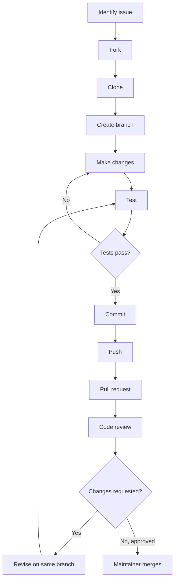

# Open Source Contribution Workflow Using Git and GitHub

A beginner-friendly academic demonstration of contributing to an existing project: identify a bug, fix a Python calculator, test the change, and submit it for review. This repository preserves its original calculator example and uses it to explain collaboration.

## Problem statement

A shared project needs a repeatable way to accept corrections without changing its main branch before review. The original calculator could not run because of Python syntax errors. This project connects a small, verifiable code fix with the Git and GitHub workflow used to propose it.

## Objectives

- Correct and demonstrate addition and subtraction.
- Verify behavior with automated tests.
- Explain forks, branches, commits, pull requests, review, and merging.
- Give students a practical contribution procedure and maintainers a review checklist.

## Technologies used

- Python 3 (verified with Python 3.12) and standard-library `unittest`.
- Git for local version control and GitHub for hosting and collaboration.
- Markdown documentation and a Mermaid workflow diagram.

No third-party Python packages, database, or web application are required.

## Repository structure

```text
open_source_contribution/
|-- calculator.py
|-- test_calculator.py
|-- README.md
|-- CONTRIBUTING.md
|-- DEMO.md
|-- .gitignore
`-- .github/
    |-- ISSUE_TEMPLATE/
    |   |-- bug_report.md
    |   `-- feature_request.md
    `-- pull_request_template.md
```

## Features

- Reusable addition and subtraction functions with a direct-run example.
- No demonstration output when imported into another Python file.
- Tests for normal operations, zero, negative and decimal values, mixed numeric types, equal operands, subtraction order, and quiet imports.
- Contribution instructions, issue and PR templates, and a classroom guide.

## Installation and setup

Install Python 3 and Git. Check them in a terminal:

```sh
python --version
git --version
```

For a local demonstration, clone the original repository:

```sh
git clone https://github.com/akilaymaan/open_source_contribution.git
cd open_source_contribution
```

For a contribution, follow the fork procedure below instead. No `pip install` step is needed. On Windows, use `py` if `python` is unavailable; on systems using `python3`, substitute that command throughout. Run Python commands from the repository root.

## Run the calculator

```sh
python calculator.py
```

Expected output:

```text
Addition: 15
Subtraction: 5
```

Pass Python integers or floats, including zero and negative numbers. Subtraction preserves operand order. This example does not accept interactive input or validate arbitrary objects; pass numbers. Floats have normal rounding limitations, so decimal tests use `assertAlmostEqual`.

## Run automated tests

```sh
python -m unittest -v
```

This discovers `test_calculator.py`. There are nine test methods; success ends with `Ran 9 tests` and `OK` (elapsed time varies). Failed assertions or import errors produce a nonzero exit status.

## Key concepts

| Term | Meaning |
| --- | --- |
| Git | Local version-control software that records and compares changes, branches, and commits. |
| GitHub | A hosting and collaboration service for Git repositories, with issues and pull requests. |
| Fork | A separate repository under a contributor's GitHub account, linked to the original. |
| Clone | A local copy of a repository and its Git history. |
| Branch | A movable reference to a line of development that isolates proposed work. |
| Commit | A recorded snapshot of staged changes with a message and parent history. |
| Push | Transfers local commits and branch updates to a remote repository. |
| Pull request (PR) | A GitHub proposal to integrate a branch into another branch, with discussion and review. |
| Code review | Inspection of the diff, behavior, tests, and documentation by another person. |
| Merge | Integration of approved work into the target branch. |

A fork is hosted on GitHub; a clone is on your computer. A branch moves as commits are added; a commit records a particular snapshot. Opening a pull request proposes integration; merging performs it.

## Complete contribution workflow

These are instructions for a future contribution, not evidence that a fork, issue, PR, review, or merge has happened. Examples assume the original default branch is `main`.

### 1. Find a repository or issue

Read this guide and [CONTRIBUTING.md](CONTRIBUTING.md). Inspect the code and existing issues to avoid duplicate work. A realistic task is: “Fix calculator syntax errors and add regression tests.” If necessary, report a reproducible defect using the bug template.

### 2. Fork on GitHub

Sign in to GitHub, open [the original repository](https://github.com/akilaymaan/open_source_contribution), select **Fork**, and create the fork under your account. Contributors can propose work without write access to the original. Maintainers may instead use a branch in the original repository.

### 3. Clone your fork

Replace `YOUR_USERNAME` with your GitHub username:

```sh
git clone https://github.com/YOUR_USERNAME/open_source_contribution.git
cd open_source_contribution
git remote add upstream https://github.com/akilaymaan/open_source_contribution.git
git remote -v
```

`origin` identifies your fork; `upstream` identifies the original. These are local aliases. In an existing clone, inspect the remotes first; do not add an existing remote again.

### 4. Create a bug-fix branch

Begin with a clean working tree. Update local `main` from the original repository:

```sh
git status
git fetch upstream
git switch main
git merge --ff-only upstream/main
git switch -c fix/calculator-syntax
```

If the fast-forward fails because histories diverged, stop and inspect the history. Do not discard changes to force the command through.

### 5. Modify the code

For the historical calculator defect, add missing colons, correct indentation and print arguments, and protect the example with `if __name__ == "__main__":`. Add regression tests. The corrected code here is the reference implementation; do not reintroduce defects to create a contribution.

### 6. Run tests and inspect changes

```sh
python calculator.py
python -m unittest -v
git diff --check
git diff
```

Check the expected output and passing tests. Keep unrelated edits and credentials out of the diff.

### 7. Stage and commit

Check your author identity with `git var GIT_AUTHOR_IDENT`. If needed, set your preferred name and email using repository-local `git config user.name` and `git config user.email`. To protect your personal email, copy your exact GitHub-provided no-reply address from GitHub email settings.

For a change that edits or adds these files:

```sh
git add calculator.py test_calculator.py
git diff --cached
git commit -m "fix: repair calculator syntax and add regression tests"
```

Stage files belonging to your actual change. A commit needs real staged changes; rerunning this on an already-correct checkout will not create another fix.

### 8. Push to the contributor's fork

```sh
git push -u origin fix/calculator-syntax
```

This requires network access, authentication, and permission to push to the fork. Use GitHub's supported sign-in method. Never put a token in code, documentation, or a remote URL.

### 9. Open a pull request

On GitHub, select **Compare & pull request** for the pushed branch. Choose:

- Base repository: `akilaymaan/open_source_contribution`; base branch: `main`.
- Head repository: your fork; compare branch: `fix/calculator-syntax`.

Describe the defect, changes, and actual test results using the PR template. Link an issue only if a real relevant issue exists. Do not invent issue numbers or approval.

### 10. Review, revise, and merge

A reviewer reads the diff and runs the program and tests. Make requested revisions on the same branch, rerun verification, then commit and push the actual revised files:

```sh
git add calculator.py test_calculator.py
git commit -m "test: cover calculator review feedback"
git push
```

The existing PR updates automatically. Use a message describing your actual revision. Resolve conflicts before merging. An authorized maintainer merges after review requirements and checks are satisfied. The owner cannot approve their own PR; use a classmate's separate account for independent review.

After the PR has actually merged:

```sh
git switch main
git fetch upstream
git merge --ff-only upstream/main
```

## Visual workflow



Revisions repeat tests, commit, and push. The push updates the same PR; another PR is unnecessary.

## Realistic bug-fix example

The original file contained `def add(a,b)` and `def subtract(a,b)` without colons. Print statements such as `print("Addition:" add(10,5))` lacked a separating comma and were incorrectly indented. Python stopped at the first missing colon before executing arithmetic.

The correction uses `def add(a, b):`, four-space indentation, and `print("Addition:", add(10, 5))`. Subtraction receives the corresponding syntax correction. The import guard separates demonstration output from reusable functions. The arithmetic intent was already correct; this fix makes it executable and verifiable.

An illustrative PR title is **Fix calculator syntax and add regression tests**. Its description would explain the observed syntax error, correction, and actual verification results. This example does not claim that a PR has been submitted.

## Benefits of open-source collaboration

- Contributors can propose focused changes without direct write access.
- Review provides additional perspectives and catches errors before integration.
- Commit history and PR discussions preserve the reasons for changes.
- Tests and clear instructions help others reproduce behavior and contribute.

## Limitations and future improvements

This teaching example has two arithmetic operations, numeric inputs supplied in code, and manually run tests. It has no interactive UI or CI pipeline. Floats are approximate. Future work could add multiplication and division with tests, input validation for a CLI, or a small GitHub Actions test workflow.

There is currently no license file. Public availability alone does not grant a general reuse license; the owner should choose appropriate licensing terms before inviting broad reuse.

## Classroom demonstration and conclusion

Follow [DEMO.md](DEMO.md) for a local exercise, GitHub permission boundaries, and a presentation script.

This project shows that contributing involves more than editing code: a reproducible report, a focused fix, automated verification, a clear commit, and human review make collaboration traceable. The calculator keeps the code small enough to explain while Git and GitHub demonstrate the contribution lifecycle.
